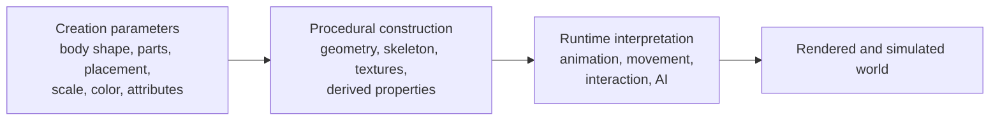
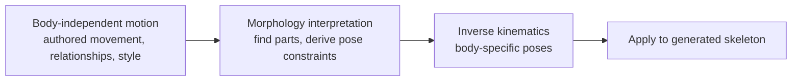
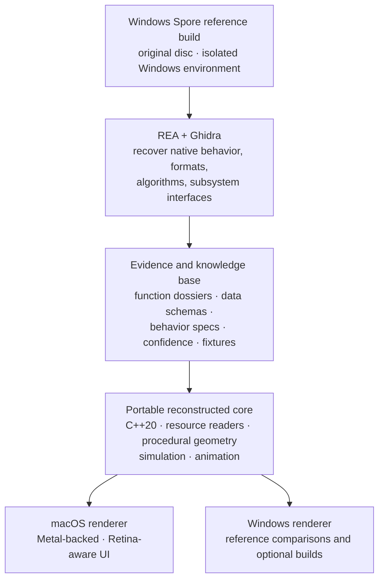

# Project Spore — Reconstruction Project Brief

Curated from the initial planning conversation (`INITIAL_BRIEF.md`, 2026-10-22). This file is
the standing project context for agent sessions; `INITIAL_BRIEF.md` remains the raw capture.

---

## Status

| Field               | Value                                                                                                                                                           |
| ------------------- | --------------------------------------------------------------------------------------------------------------------------------------------------------------- |
| Current phase       | **3–4 — formats decoded (container/index/.prop/mount/RW4); first reconstructed creature body assembled (INV-016)**                                              |
| Last updated        | 2026-10-23 (late)                                                                                                                                               |
| Reference runtime   | **None; native-only (D2 closed 2026-10-23).** CrossOver launch (INV-035) exists but is not part of the roadmap                                                  |
| Milestone C         | Interactive native macOS creature viewer built (INV-033): `~/Documents/spore/viewer/run.sh` — real assembled parts, proxy spine skin, no textures/animation yet |
| Next investigation  | **E0 mapping sprint** (renderer, `CompiledState` materials, input, main loop); then E1 engine foundation. Roadmap: `spore/docs/ROADMAP.md`, Appendix E          |
| Evidence ledger     | `spore_briefs/evidence-ledger.md`                                                                                                                               |
| Analysis target     | **GOG SPORE Collection 3.1.0.29**: SecuROM-free. Revised D1, see §4.3                                                                                           |
| Preservation master | Retail disc image `SPORE.cdr`, SHA-256 `2c2d5bce…67fc773` (§4.3.1)                                                                                              |
| Environment         | Ghidra 12.1.4 + Temurin 21 (arm64) + REA registered with Claude Code; see `spore/env/README.md`                                                                 |
| Team                | Solo, expecting collaborators (ledger claiming rules in §10)                                                                                                    |
| Compute budget      | Unlimited inference (sponsored — see below)                                                                                                                     |

**Sponsorship:** inference compute for this project is sponsored by
**Runars — Canadian AI Inference**.


> **Using this file in an agent session:** read this brief, then the evidence ledger if it
> exists, then continue the next open investigation. Update the ledger and the Status block
> when conclusions land. Do not restate the whole brief back; work from it.

**Local-only notice:** `spore_briefs/` is a local planning artifact. Per the REA repository
guidelines, never commit it, disc images, extracted assets, or provider project files.

---

## 1. Objective

**Recreate the original Spore (Maxis, 2008) faithfully** — observable behavior, not just
appearance: creature creation, procedural geometry, animation, AI, progression, simulation,
UI, and the transitions between the five gameplay stages.

- **Reference target:** original Windows PC disc release (the copy in hand).
- **Delivery target:** native macOS application, 4K-capable, with a portable core so Windows
  and Linux builds remain possible.
- **Non-goal:** recovering the original source code. Compiled binaries do not yield the
  original source tree, build environment, or internal documentation. The output is
  independently written code validated against original behavior.
- **Approach:** preservation engineering. REA is the investigation layer, never the game
  engine; recovered evidence stays independent of implementation language and engine.

Fidelity means reproducing behavior. It does **not** mean reproducing the original's display
limitations (see §7) or shipping a pixel-identical renderer — structural and behavioral
equivalence are the early targets, because exact pixel matching is impractical across
graphics drivers and floating-point behavior.

## 2. Operating principles

1. **Evidence before inference.** Every substantive conclusion carries an evidence reference
   and a confidence tag. Never assume function names, class names, or file formats.
2. **One investigation at a time.** Never ask an agent to "reverse engineer all of Spore";
   that produces speculative documentation. Small, testable investigations compound.
3. **Reuse before rediscovery.** Check community-recovered symbols and types (Spore ModAPI)
   before spending agent time re-deriving them.
4. **Phases are gates.** Each phase exists to expose the riskiest unknown before the next
   investment. A failed or expensive gate is a result, not a setback.
5. **Original media stays pristine.** Read-only master images, recorded hashes, working
   copies only. No patching or modification of original executable bytes.
6. **Keep copyrighted material private.** Disc-derived binaries and assets never leave local
   storage; analysis and independently written implementation stay separate from them (§12).

Confidence tags used throughout:

| Tag    | Meaning                                                 |
| ------ | ------------------------------------------------------- |
| `[D]`  | Documented — from interviews, papers, or the ModAPI SDK |
| `[SI]` | Strong inference — supported but not directly confirmed |
| `[NE]` | Not established — open question, requires investigation |

---

## 3. What is known about Spore's architecture

The central architectural finding `[D]`: Spore was not a conventional engine with five level
types. It was built around shared procedural systems that turn player-created data into
working creatures, vehicles, buildings, environments, and simulations.

### 3.1 Data-driven content pipeline `[D]` (conceptual model)



Key implication: **a creature is not merely a mesh.** Its editable representation must
preserve enough information to regenerate geometry, support animation, determine gameplay
capabilities, and serialize the creation for sharing. Data formats must be approached with
that in mind. (Will Wright, 2006 interview `[D]`.)

### 3.2 Procedural animation — the strongest technical evidence

From Chris Hecker's SIGGRAPH 2008 paper _Real-Time Motion Retargeting to Highly Varied
User-Created Morphologies_ and GDC presentations `[D]`:



The system cannot assume a known skeleton — players create arbitrary morphologies (many
limbs, multiple heads, no conventional limbs). Three separable investigation tracks:

1. How the generated skeleton and body-part hierarchy are represented.
2. How the game finds a suitable limb/head/mouth for an animation instruction.
3. How it solves constraints and handles missing or ambiguous parts.

The published paper explains algorithmic intent independently of the binary — use it as the
algorithmic reference and let REA recover the shipped specifics.

### 3.3 Procedural texturing and model construction `[D]`

Maxis SIGGRAPH 2007 technical sketches (primary sources):

- **Creature texturing** — main body mesh with attached detail parts; the Swarm effects
  system runs particle-driven brushes over mesh surfaces; a splatting shader combines
  individual textures into a texture page; an ambient-occlusion map unifies appearance.
- **Rigblocks** — buildings and vehicles assembled from deformable parts; procedural UV
  system with planar, cylindrical, and box projections so textures survive deformation.
- **Spherical worlds** — planet generation and object distribution with controlled
  variation (fast distribution technique; incremental Halton-sequence example).

Conclusion: Spore relied on several specialized procedural systems, not one generic
algorithm. Treat these as separate research tracks: creature geometry, procedural
materials, deformable construction parts, planetary terrain, object placement.

### 3.4 Resource system and data formats `[D]`

From the Spore ModAPI SDK documentation:

- `.package` files contain the game's resources; `.prop` files are property lists assigning
  values to named properties.
- Resources are accessed through the game's resource and I/O systems; models, UI elements,
  effects, and other content have established interfaces and file types.
- Modern community tooling describes resources with **group / instance / type** identifiers
  and FNV-based hashes. `[SI]` — validate exact details against the disc version in hand.

Architectural consequence: the disc is **not** a flat collection of independent assets.
Reconstruct the relationships between resource identifiers, archive entries, property
references, and the code that loads them.

**Ground-truth bonus `[D]`:** official patch 5.1 (March 2011) added an in-game **COLLADA
creature exporter**. That is a publisher-sanctioned dump of the procedural creature
pipeline's output — an authoritative cross-check for our own format recovery and a
regression fixture source for the fidelity scorecard (§8). Capturing exporter output for a
fixed set of creature configurations belongs in Phase 3 planning.

### 3.5 Native object model `[D]` / `[NE]`

The ModAPI SDK contains C++ headers, function declarations, known addresses, data
structures, and detouring support (static, non-virtual member, and virtual method detours)
— evidence the community recovered meaningful parts of the native object model. It does
**not** provide the original source tree, all class definitions, or the full inheritance
hierarchy; the SDK's own guidance warns that decompilers do not automatically understand
inheritance, virtual dispatch, or reference-counting patterns. `[NE]`

### 3.6 One engine, five gameplay stages

The five stages (cell, creature, tribal, civilization, space) are visibly different genres
`[D]`. Wright described ~80 staff with a high programmer ratio due to procedural systems,
and cross-team integration dependencies `[D]`.

- `[D]` Stages required integration; several procedural systems served multiple parts.
- `[SI]` Shared services (resources, rendering, animation, simulation, content generation)
  enabled that integration.
- `[NE]` Exact module boundaries; whether each stage is a separate runtime subsystem; the
  original build graph. Do **not** assume every stage uses the same simulation model —
  investigate what is genuinely shared vs. stage-specific.

### 3.7 Open technical unknowns

| Question                                            | Status                                                                                                                                       |
| --------------------------------------------------- | -------------------------------------------------------------------------------------------------------------------------------------------- |
| Exact source language and compiler settings         | Toolchain observed (INV-000): retail 2008 build MSVC 7.1 (linker 7.10, msvcr71); GOG 2024 build MSVC 9.0 (linker 9.0, msvcr90). Flags `[NE]` |
| Complete engine module map                          | `[NE]` not publicly documented                                                                                                               |
| Original memory allocator and object lifetime rules | Partially recoverable via SDK + binary analysis                                                                                              |
| Complete animation implementation                   | `[D]` core technique published; `[NE]` full implementation                                                                                   |
| Complete save-game and serialization formats        | `[NE]` requires investigation                                                                                                                |
| Full planet-generation algorithm                    | `[D]` research exists; `[NE]` shipped implementation needs validation                                                                        |
| Exact resource-loading and caching behavior         | Partially documented; `[NE]` binary and runtime analysis required                                                                            |
| All gameplay rules and AI behaviors                 | `[NE]` not covered by public papers                                                                                                          |

These are not equally hard unknowns: several major algorithms are published, and the
community has mapped many functions and data structures already.

---

## 4. Execution plan

Estimates are planning ranges for one experienced engineer working with AI coding agents —
not delivery dates. Phases 0–4 are gates that should re-rank everything after them.

### 4.1 Phases

| Phase                                   | Scope                                                                                                                                                            | Estimate            | Deliverable (gate)                                                       |
| --------------------------------------- | ---------------------------------------------------------------------------------------------------------------------------------------------------------------- | ------------------- | ------------------------------------------------------------------------ |
| **0 — Preserve and inventory**          | Read-only master image of the disc, hashes, working copy, full file manifest; record edition, executable architecture, language, patches, installer dependencies | 1–3 days            | Reproducible baseline and file manifest                                  |
| **1 — Prove REA works on the game**     | Install REA + Ghidra; identify main PE executable and DLLs; validate function discovery, decompilation, xrefs, large-binary handling                             | 3–7 days            | Tested toolchain + executable structure report                           |
| **2 — Map the engine**                  | Trace startup, resource loading, rendering, input, simulation, serialization, stage transitions via strings, imports, call refs, runtime observation             | 2–6 weeks           | Dependency graph + evidence-backed technical spec                        |
| **3 — Decode assets and creature data** | Archive formats; extract representative models/textures; document creature-part representation and attachment rules; read-only inspection tools first            | 2–8 weeks (initial) | Resource browser + working reader for one important format               |
| **4 — First vertical slice**            | Load a real creature configuration → reconstruct parts and attachments → generate geometry → render a recognizable creature                                      | 4–12 weeks          | Working, testable creature reconstruction                                |
| **5 — Expand toward the complete game** | Editing, animation, AI, world simulation, progression, stage gameplay, UI, audio, save compatibility, stage transitions                                          | months–years        | Increasingly complete implementation, measured against original behavior |

**Phase 4 is the recommended vertical slice** (INV-015 found its concrete chain: `CRT` XML creature → `blockref` keys in group `40626000` → block prop + `blockdata` → RW4 models in group `40606000`): the creature pipeline is central to Spore's
identity, combines binary analysis with procedural algorithms, and gives a clear path from
one real input file to a visible, testable result.

### 4.2 Milestones A–D (near-term edge of Phases 0–2)

| Milestone                             | Weeks     | Content                                                                                                        | Maps to                                                                                                                                                                                                                                                                   |
| ------------------------------------- | --------- | -------------------------------------------------------------------------------------------------------------- | ------------------------------------------------------------------------------------------------------------------------------------------------------------------------------------------------------------------------------------------------------------------------- |
| **A — Mac development environment**   | 1–2       | Run REA + Ghidra; establish the original Windows game as reference; compile a minimal native macOS application | Phase 0–1                                                                                                                                                                                                                                                                 |
| **B — 4K rendering and UI prototype** | 2–4       | Test scene at 3840×2160: correct Retina scaling, readable text, responsive hitboxes, stable frame pacing       | Parallel track (§7)                                                                                                                                                                                                                                                       |
| **C — First reconstructed creature**  | 4–12      | Load a real creature configuration, generate its geometry, render it on the new pipeline                       | Phase 3–4 (**first bodies assembled 2026-10-23**: CRT XML spines and premade `creatureData` skeletons (34 blocks, limbs/head) → RW4 meshes, wireframe; pose and skin colours match the game's thumbnail; shaded skeleton render exists; no skin surface/textures/rig yet) |
| **D — Full gameplay reconstruction**  | long-term | Expand shared engine + stage gameplay; macOS/4K remain continuous regression targets                           | Phase 5                                                                                                                                                                                                                                                                   |

### 4.3 Version decision (D1 — revised 2026-10-23)

**Current decision: analyze the GOG SPORE Collection 3.1.0.29 binaries; the retail disc
image is the preservation master and a separate asset/behavior reference.**

Why it was revised (INV-000, observed):

- The retail disc's `SporeApp.exe` (FileVersion 1.1.0.338) is wrapped by **SecuROM 7.37**
  (`.securom`/`Stext`/`Sitext`/… sections; entry point inside `Sitext`; wrapper PDB path
  `…\SecuROM-DRM_7_37\…\wrapper.pdb`), and `paul.dll`/`WINUI.dll` are SecuROM PA
  activation components. Static analysis of the disc binary would mostly see encrypted
  code, and working around it raises a circumvention question (D5). It is also unknown
  whether patch 5.1 removes the wrapper.
- The purchased GOG build has no SecuROM. It has a plain `.text` section and is signed,
  so it can be analyzed without touching DRM.

Consequences:

- **Different lineage from the 1.5.1 retail baseline.** The GOG executables are a 2024
  rebuild (MSVC 9.0 / VS2008; PE timestamps 2024-09-30/10-01; build path
  `c:\BuildAgent\max-spore001-spore\CMBuild\SporeEP1_RL\…`). Before reusing any ModAPI
  symbols, check whether ModAPI has data for this build. `[NE]`
- **Two executables ship:** `SporeBin/SporeApp.exe` (FileVersion 1.3.0.29) and
  `SporebinEP1/SporeApp.exe` (3.1.0.29, Galactic Adventures; this is GOG's primary play
  task). Their `.text` sections are the same size but differ byte-for-byte. Choosing the
  primary target is open decision D8.
- **ASLR:** both have `DYNAMIC_BASE` and a `.reloc` section (preferred base `0x400000`).
  Ledger entries should cite RVAs, or VAs at the preferred base, never runtime addresses.
- **Assets differ by lineage:** all five shared `.package` files differ in hash and size
  between the disc and GOG, and GOG adds `PatchData`, `Spore_Pack_03`, EP1 and
  BoosterPack packages. Fixtures must record which lineage they came from.
- The retail 1.5.1 patch path (below) is kept only as an optional later cross-check.

Original 2026-10-22 rationale for the 1.5.1 disc lineage (superseded):

- The ModAPI community's symbols, addresses, and Ghidra import data target the 1.5.1-era
  executables — analyzing 1.5.1 maximizes symbol reuse (§2, principle 3).
- The 1.5.1 patch installer is the documented update path for **disc/retail** installs;
  digital releases (EA App/Steam) already ship at 1.5.1-equivalent or newer. `[D]`
- The disc stays pristine regardless: Phase 0 hashes the original media once and never
  writes to it; the patch is applied only to a working copy in the Windows reference
  environment.
- Both lineages can coexist as long as evidence chains never mix them: every ledger entry
  records the exact executable hash it analyzed.

Consequences: the community COLLADA exporter and 1.5.1 ModAPI data become available as
cross-checks; the disc's 1.0 binaries are still worth a light inventory pass (Phase 0) for
preservation and for diffing patch deltas later if needed.

#### 4.3.1 Acquisition pipeline — image the disc, never download a game copy

**Done (2026-10-23, INV-000):**

- **Disc master:** imaged by the operator, offline, on a Mac with a built-in optical drive,
  using Disk Utility (DVD/CD master format). Result: `~/Documents/spore/spore_master/SPORE.cdr`,
  4,142,563,328 bytes, matching the ISO volume size (2,022,736 × 2048), so the image is
  not truncated. SHA-256 `2c2d5bce716175c0eb7ea451de1246b41d7f23c5a80c8cd7fa5eaa88f67fc773`,
  SHA-1 `d08d1985d3161661d4f0ded30a0d11e705f2fcc2`, MD5 `0ad66fff7854c03f44b02c08db781d31`.
  Not yet done: a second read to compare hashes, and write-protecting the file.
- **GOG analysis source:** operator's own GOG purchase, made on another laptop and
  transferred here by AirDrop. Offline installer set
  `setup_sporetm_collection_3.1.0.29_(77221)` (.exe + -1.bin + -2.bin; hashes in the
  ledger). The installer is GOG-signed. `innoextract 1.9 --test` passed. Extracted to
  `~/Documents/spore/spore_work/gog-3.1.0.29/` (1,636 files, 5.9 GB).
- **Manifests:** `manifest-disc.json` (1,484 files) and `manifest-gog-3.1.0.29.json`
  (1,636 files), SHA-256 for every file.

The original disc-only chain is below (step 3 and later are now optional):

```
Physical disc (master, read-only, archived in original package)
   │  1. dd read → ISO/BIN master image  →  record SHA-256  →  store offline
   ▼
Disc image (working master, local)
   │  2. install into the Windows reference environment (D2) from the image
   ▼
Authentic 1.0 install (working copy)
   │  3. apply official patch 5.1 installer (hash-verified against community
   │     records — Risk 11) to the working copy only
   ▼
Authentic 1.5.1 install  ←  ANALYSIS TARGET
   │  4. copy the resulting PE executables/DLLs out for REA/Ghidra analysis
   ▼
Analysis corpus (hashed, referenced by every ledger entry)
```

Rules that fall out of this:

- **Never download a full game copy from mirrors or archive rips.** Third-party disc
  images are uncontrolled: rips frequently have DRM removed or cracks baked in, so the
  binaries differ from the authentic patched executables the ModAPI symbol data targets.
  Analyzing a tampered binary silently poisons every address, symbol, and hash in the
  knowledge base — the one failure mode this project cannot recover from cheaply. The
  _patch installer_ from a reputable mirror is the only acceptable non-disc artifact, and
  only after hash verification. **Known artifacts ruled out (2026-10-22):** a Pirate Bay
  torrent of the GOG Collection repack (2.0.0.5, DRM-free, GA-integrated;
  `~/Downloads/SPORE.Collection-GOG`) and a scene-style RAR tagged v3.1.0.29
  (`~/Downloads/SPORE.Collection.v3.1.0.29.rar`, newer than GOG's advertised 3.1.0.22 —
  untrusted bytes, zero information value over the store page) — both excluded as
  analysis sources on provenance (§12) and binary-lineage grounds. Do not use them for
  analysis, reference behavior, or fixtures. A _purchased_ GOG copy, if still listed, would be a legitimate third variant
  with its own ModAPI symbol baseline — but only the retail 1.5.1 lineage is in scope.
- **The patch modifies the working install, never the disc or the image.** The 1.0 image
  stays bit-identical forever; re-deriving any later state is always possible.
- **Digital purchase (optional, ~C$10 on EA App/Steam) is a legitimate secondary variant**
  — an authentic, publisher-delivered 1.5.1+ install useful for cross-validating that the
  patched-disc binaries match the community's symbol baseline. It supplements the disc
  chain; it does not replace it.
- **Purchased GOG Collection (optional third variant)** — legitimately sold DRM-free at
  [gog.com/en/game/spore_collection](https://www.gog.com/en/game/spore_collection) (~C$20
  as of 2026-10-22, on sale; current build **3.1.0.22 GOG v2.hotfix**, Oct 2025, part of
  GOG's Preservation Program; includes Spore + Galactic Adventures + Creepy & Cute).
  Verified available. This is a _different binary lineage_ from retail 1.5.1 — DRM-free
  repackage, GA-integrated, GOG launcher/config tool. Community ModAPI data has baselines
  for specific GOG builds, but 3.1.0.22 is newer than the ones the repack scene targeted
  (2.0.0.5), so symbol coverage must be checked before any reuse. Value: an authentic
  publisher-delivered reference for behavior and assets; a candidate for comparing how the
  GA-integrated build structures what the disc ships separately. **Superseded 2026-10-23:
  this is now the analysis target (see §4.3).** Version note: the purchased installer is
  3.1.0.29 (binaries built 2024-09/10). That conflicts with the 3.1.0.22 (Oct 2025) store
  build recorded above; which is current on GOG is unresolved `[NE]`.
- Every corpus file gets its SHA-256 recorded at step 4; ledger entries cite the hash, not
  the filename, so a future re-extraction can be validated byte-for-byte.

### 4.4 First 30 days

- **Week 1** — preserve the disc, install the game in an isolated environment, establish the
  toolchain, identify executables and resource archives.
- **Week 2** — map startup and resource loading; exercise REA's decompiler workflow on
  representative functions.
- **Week 3** — identify one creature-related data path; document the format as far as
  evidence allows.
- **Week 4** — build a minimal parser/inspection tool; validate against real disc files.

End-of-month success criterion: not "recreated Spore," but a demonstrated, repeatable path
**original binary/asset → verified understanding → independently implemented, tested
behavior.**

---

## 5. Technical stack

The reverse-engineering environment and the reconstruction environment stay separate.

| Component        | Choice                                                                           | Reason                                                                        |
| ---------------- | -------------------------------------------------------------------------------- | ----------------------------------------------------------------------------- |
| Binary analysis  | REA + Ghidra                                                                     | Primary investigation workflow for the native Windows binaries (§9)           |
| Agent            | Claude Code (or Codex)                                                           | Structured investigations, code, tests                                        |
| Analysis scripts | Python                                                                           | Rapid file-format inspection, extraction, binary experiments                  |
| Reimplementation | C++20 (portable core)                                                            | Control over memory layouts, binary formats, performance, procedural geometry |
| Rendering        | Portable abstraction; **Metal-backed macOS renderer**, optional Windows renderer | Establish graphics requirements without premature engine commitment           |
| Testing          | Automated regression fixtures                                                    | Compare reconstructed outputs against recorded original behavior              |
| Knowledge base   | Markdown + JSON (this directory)                                                 | Version-controlled findings, function maps, format schemas, confidence levels |

**Do not commit to Godot or Unreal up front.** Either could work, but a faithful port needs
a custom compatibility layer for original data formats, simulation timing, and procedural
geometry. A small renderer behind an abstraction avoids premature engine assumptions; the
abstraction seam is what keeps the door open for later engine choices.

## 6. Target architecture



The game logic and content interpretation must not depend on a particular graphics API —
that is what makes procedural geometry and simulation validatable independently of Metal,
Direct3D, or any other backend.

## 7. macOS and 4K requirements

Two separate targets, both first-class from the start:

1. **Run the original Windows release** for reference and testing (isolated Windows
   environment or compatibility layer; see §9.5).
2. **Build the recreated game** as a native macOS application with proper Retina/4K
   rendering and UI scaling.

The original macOS release of Spore is **not** a viable foundation `[D]`: it is 32-bit and
therefore incompatible with macOS Catalina and later. The Windows executable is the
reference target.

### 7.1 What 4K actually requires

3840×2160 = 8.29 M pixels/frame — 4× 1080p. Modern Apple Silicon handles the raw workload;
the interesting problems are the original's legacy assumptions `[D]`:

- The original accepts custom resolutions via `-r:3840x2160`, but its UI does not scale —
  button hitboxes misalign at 4K (PCGamingWiki). `[D]`
- Therefore a faithful recreation must **distinguish original art from original display
  limitations**.

| Concern                   | Approach                                                                                                                                                          |
| ------------------------- | ----------------------------------------------------------------------------------------------------------------------------------------------------------------- |
| Resolution-independent UI | Logical UI coordinates; interface elements scale independently of render resolution; text, buttons, tooltips, and hitboxes share one layout transform             |
| Original asset fidelity   | Preserve original meshes, textures, shaders, material behavior; 4K does **not** mean AI-upscaling low-resolution source textures                                  |
| Modern rendering pipeline | Metal-backed renderer; 4K render targets; texture memory management; validate shader behavior against original; resolution-aware post-processing and antialiasing |

Two presentation modes:

- **Original presentation** — reproduce original proportions, UI sizing, colors, effects as
  closely as practical.
- **Enhanced 4K presentation** — original artistic style with improved UI legibility,
  high-DPI behavior, and rendering quality.

### 7.2 macOS implementation details

- **Build:** CMake-based C++ project; Apple Silicon (arm64) initial target.
- **Graphics:** Metal 4 via metal-cpp behind a thin abstraction (D4): native BC textures, argument buffers/bindless, `MTLIOCommandQueue` streaming, EDR (`rgba16Float`, Display P3), MetalFX temporal upscaling and frame interpolation, `CAMetalDisplayLink` pacing at 60/120 Hz. Floor: Apple silicon, 16 GB.
- **Windowing/input:** native macOS window management, mouse/keyboard, fullscreen, correct
  Retina backing scale.
- **UI:** layout system separating logical coordinates from physical pixels — a 2× Retina
  scale must not double the apparent size of every element.
- **Assets:** asynchronous loading, caching, mipmaps, memory budgets for large textures.
- **Compatibility:** explicit testing of save files, timing, input behavior, resource
  handling.

4K render resolution and UI scale are **separate settings**: the game can render at
3840×2160 while presenting controls at an appropriate logical size.

---

## 8. Fidelity scorecard

A visually similar game is not behaviorally faithful. Establish this scorecard early and
keep deterministic tests in it:

| Dimension                | Target                                                               |
| ------------------------ | -------------------------------------------------------------------- |
| **Asset fidelity**       | Original creature parts, textures, models, sounds load correctly     |
| **Procedural fidelity**  | Same creature configuration → matching geometry and attachments      |
| **Simulation fidelity**  | Movement, AI, combat, progression follow the original rules          |
| **Interaction fidelity** | Editing tools, controls, menus, stage transitions behave as expected |
| **Persistence fidelity** | Save/load preserves creature state and relevant world progress       |

Deterministic anchors: same input creature configuration → same attachment graph and
comparable mesh; same starting state and inputs → expected simulation step result. Exact
pixel-for-pixel matching is impractical (drivers, floating point, rendering differences) —
target structural and behavioral equivalence first.

---

## 9. REA workflow

REA connects an AI agent to native-binary analysis tooling and returns evidence the agent
can act on. It is the investigation layer only; it does not recover source code
automatically, and the investigator still interprets results, resolves ambiguities, and
validates reconstructed behavior.

### 9.1 Toolchain and authority

- Analysis is **read-only**: REA imports targets into ephemeral Ghidra databases, executable
  bytes are never modified, and GUI-controlled persistent databases are off-limits. This
  matches operating principle 5 by construction. (`docs/ghidra-provider.md`)
- On macOS/Linux, REA supports read-only analysis plus **atomic function-name and
  entry-comment edits** — recovered names can be applied in-session with provenance.
- The main Windows executable is a 32-bit x86 PE. On a macOS host with the Ghidra provider
  this is read-only analysis as usual; if analysis ever moves to a Windows host, note the
  Windows P0 admission boundary (x64 PE in npm releases through 5.0.0; native x86 PE on
  repository main). (`docs/windows-ghidra-p0.md`)
- Providers: Ghidra is the planned default; Hopper and IDA are alternates. Ghidra and IDA
  are bring-your-own; `rea setup` shows planned changes and asks approval before writing.

### 9.6 Environment setup checklist (nothing installed yet)

Host: this Mac (Apple Silicon). All steps verified against `docs/installation.md` in this
repository.

1. **Node.js toolchain** — use the repository-pinned version (`.nvmrc`,
   `package.json#packageManager`); on Cursor Cloud prefix `PATH="/usr/local/bin:$PATH"`.
2. **Install REA** — `npx rea-agents setup` (official sources only:
   [morluto/rea](https://github.com/morluto/rea), [rea.tools](https://rea.tools/)). Setup
   registers REA with the agent and installs matching workflow instructions.
3. **Install Ghidra 12.1.x** (verified with 12.1.4) — bring-your-own, operator-installed.
   macOS x64/arm64 is a supported host.
4. **Install a 64-bit full JDK 21+** inside Ghidra's declared Java range; point `JAVA_HOME`
   at it. **Apple Silicon gotcha:** the JDK must run natively (arm64) — a JDK under Rosetta
   (x86_64) or a non-host `os.name` fails `rea doctor` even if otherwise valid.
5. **Verify** — `rea doctor --provider ghidra --json` (engine),
   `rea doctor --client <your-agent> --json` (registration),
   `rea doctor --skill --json` (workflow instructions). Fix per remediation output.
6. **Smoke test on a benign target** — a small native binary you own, not Spore:
   `rea inspect <binary> --provider ghidra --json` and one `rea decompile`. Confirms the
   full path works before Phase 1 spends analysis time on a large PE.
7. **Tune for the Spore executables** — startup timeout and resource controls
   (`REA_GHIDRA_STARTUP_TIMEOUT_MS` and friends) exist because large imports take time;
   Phase 1 measures and sets them (Risk 4).

Steps 3–4 are the only manual installs; `rea setup` handles the rest and shows its plan
before writing anything. Setup never installs unrelated software (no Homebrew, Node.js, or
Java installation by REA itself).

### 9.2 Core loop and commands

```bash
rea inspect /abs/path/SporeApp.exe --provider ghidra --json
rea search  /abs/path/SporeApp.exe <pattern> --kind procedures --provider ghidra --json
rea function    /abs/path/SporeApp.exe --procedure=<name-or-address> --provider ghidra --json
rea instructions /abs/path/SporeApp.exe --procedure=<name-or-address> --provider ghidra --json
rea decompile   /abs/path/SporeApp.exe --procedure=<name-or-address> --provider ghidra --json
rea xrefs       /abs/path/SporeApp.exe --address=<name-or-address> --provider ghidra --json
rea trace       /abs/path/SporeApp.exe --query=<text> --provider ghidra --json
```

Select exact names/addresses from returned inventories; do not assume an entry function
named `entry`. MCP equivalents: `open_binary`, `list_procedures`, `analyze_function`, etc.
(`docs/native-investigation.md`)

Per-investigation loop (§2 principle 2):

1. Form a specific hypothesis — _"this function deserializes a creature-part record."_
2. Gather evidence: function dossier, callers/callees, xrefs, strings, assembly.
3. Document uncertainty: observed facts vs. inferred structures vs. open questions.
4. Design a discriminating test: representative input, observed original behavior, or two
   records differing in exactly one feature.
5. Implement independently: small parser/function with a narrow, explicit contract.
6. Run regression tests: input, expected output, evidence references, result.

### 9.3 Evidence and session semantics

- REA results keep observed, derived, and inferred relationships distinct; missing coverage
  is reported as **unknown**, not absence; limitations travel inside Evidence. The project
  ledger (§10) mirrors exactly this discipline. (`docs/tool-design.md`)
- Ghidra databases are **ephemeral** — one import per program per session. Two
  consequences: (a) Phase 1 must measure re-import/analysis cost on the Spore executables
  and tune startup deadlines/resource controls; (b) annotations made in an external,
  persistent Ghidra project do not persist into REA sessions. Symbol identity therefore
  lives in the knowledge base as name↔address maps; REA's atomic function-name/comment
  edits carry recovered names within a session.
- One deep provider stays bound to the target; a runtime failure never silently switches
  providers. Pseudocode is provider-specific — Ghidra observations are not equivalent to
  another engine's output.

### 9.4 Seeding from Spore ModAPI

1. Acquire the ModAPI SDK; identify its **disk-installation-variant** Ghidra import data,
   recovered headers, and source reconstructions. Its docs require choosing the import data
   matching the exact executable variant — start from the executable you own, record its
   hash and version, and verify which addresses/symbols match before reuse. Never assume an
   address or class layout transfers between releases. `[D]`
2. Use REA to investigate gaps: unresolved functions, call relationships, resource loading,
   undocumented behavior.
3. Use the SIGGRAPH work as the algorithmic reference for procedural animation, texturing,
   and world generation (§3.2–3.3).
4. Build a traceable specification connecting each reconstructed feature to its original
   data structures, functions, and observed runtime behavior.

This combination is substantially more promising than asking an agent to reverse engineer
the game from scratch.

### 9.5 Runtime reference environment

Static analysis happens on this Mac. Running the original game for behavioral ground truth
needs a Windows environment (VM or compatibility layer). Candidates — unverified, decide in
Phase 0/1: Windows VM (note: x86 emulation on Apple Silicon has performance costs),
CrossOver/Wine. Whatever is chosen, capture reference behavior (screenshots, inputs, save
states, outputs) into the evidence store, and keep the analysis target (the disc binaries)
distinct from any runtime convenience copy — see the version-mixing risk in §11.

---

## 10. Evidence ledger conventions

One file per project (`spore_briefs/evidence-ledger.md`), one entry per investigation.
Confidence tags match REA's own observed/derived/inferred discipline.

```markdown
## INV-00N: <hypothesis title>

- Status: open | confirmed | refuted | partially confirmed
- Confidence: observed | strongly inferred | unverified
- Claimed by: <name/session> — date range
- Target: <binary/file + procedure/address, or asset path + executable hash>
- Evidence: <REA evidence refs, command outputs, fixture paths, screenshots>
- Findings: observed facts / inferences / unresolved questions (separated)
- Discriminating test: what would confirm or refute
- Follow-ups: next investigations this unlocks
```

Rules: every substantive conclusion carries an evidence reference; unknowns stay unknown
instead of becoming plausible guesses; the Status block in this brief updates when a phase
or gate outcome changes.

**Collaborator claiming rules** (adopt now — solo today, collaborators expected):

- Claim before working: set `Claimed by:` on an `open` entry before starting the
  investigation; move it back to unclaimed if abandoned, with findings so far preserved.
- One claim per investigation; a second session extends an existing entry rather than
  opening a parallel one.
- Every entry records the exact executable hash analyzed — with a patch lineage in play
  (1.0 disc vs 1.5.1), hash discipline is what prevents cross-version contamination
  (Risk 2).
- Merge conflicts on the ledger resolve in favor of the entry with more evidence, never by
  overwriting; contested findings stay open with both positions recorded.

---

## 11. Risk register

| #   | Risk                                                                                                                        | Where it bites                  | Impact                                                                              | Mitigation                                                                                                                                                                                                                                                      |
| --- | --------------------------------------------------------------------------------------------------------------------------- | ------------------------------- | ----------------------------------------------------------------------------------- | --------------------------------------------------------------------------------------------------------------------------------------------------------------------------------------------------------------------------------------------------------------- |
| 1   | Creature-data format proves unusually difficult                                                                             | Phase 3 gate                    | Re-planning                                                                         | Phases are gates — decide before Phase 4 investment; fall back to a different vertical slice if needed; 5.1 COLLADA exporter output is a ground-truth cross-check (§3.4)                                                                                        |
| 2   | Address/symbol drift between game versions (disc 1.0 vs community-targeted 1.5.1)                                           | Phase 1–2                       | Wrong mappings silently poison the knowledge base                                   | **Resolved by version decision (§4.3): analyze 1.5.1.** Still pin executable hash per ledger entry; never mix lineages in one evidence chain                                                                                                                    |
| 3   | ModAPI coverage gaps for the exact disc variant                                                                             | Phase 1                         | More de-novo work than planned                                                      | Coverage check is an explicit Phase 1 task; analyzing 1.5.1 minimizes (not eliminates) this                                                                                                                                                                     |
| 4   | Ephemeral Ghidra DB re-analysis cost on large PEs, every session                                                            | Phase 1 onward                  | Wasted analysis time                                                                | Measure in Phase 1; tune startup/resource controls; keep heavy manual RE in a separate persistent Ghidra project if needed                                                                                                                                      |
| 5   | Disc DRM: **observed** (INV-000), SecuROM 7.37 wrapper on the disc `SporeApp.exe`, plus PA activation DLLs                  | Phase 0–1                       | Disc binary not statically analyzable; install/reference environment may be blocked | **Mitigated for analysis by D1 revision:** analyze the SecuROM-free GOG build instead. Never let DRM handling touch REA's read-only analysis                                                                                                                    |
| 13  | Disc install may need SecuROM online activation; activation server availability unknown `[NE]`                              | Disc reference environment only | Retail 2008 behavior can't be captured                                              | GOG build is the runtime reference by default; test disc install only if 2008-behavior capture is ever needed                                                                                                                                                   |
| 14  | GOG 2024 rebuild may not match ModAPI symbol baselines                                                                      | Phase 1                         | More de-novo naming                                                                 | **Partly mitigated (INV-006):** 72.0% of ModAPI march2017 addresses are function entries in GOG EP1 (vs 5.4% chance); disk-baseline 8.7%. Two matches verified by behaviour; the rest unverified. Use march2017 data as the seed, verify each use               |
| 6   | Scope explosion in Phase 5 (five stages × full gameplay)                                                                    | Phase 5                         | Project stalls                                                                      | Stage-by-stage scorecard; fidelity anchors per stage; gate each stage on the previous                                                                                                                                                                           |
| 7   | Original macOS release is a 32-bit dead end `[D]`                                                                           | Reference environment           | Wrong reference target                                                              | Windows release is the reference (§7); runtime via VM/compatibility layer                                                                                                                                                                                       |
| 8   | Agent hallucination — plausible but unsupported structures entering the knowledge base                                      | All phases                      | Corrupt evidence, wasted rework                                                     | Evidence ledger discipline; discriminating tests; never assume names/formats without evidence (§2)                                                                                                                                                              |
| 9   | Floating-point/driver nondeterminism blocks "exact" matching                                                                | Phase 4+                        | Chasing impossible goal                                                             | Structural/behavioral equivalence targets (§8)                                                                                                                                                                                                                  |
| 10  | Legal exposure (EULA anti-RE terms, DRM, distribution)                                                                      | All phases                      | Project-ending if material leaks                                                    | §12; keep copyrighted material private; legal review before any distribution (Open decision D5)                                                                                                                                                                 |
| 11  | 1.5.1 patch source integrity — community mirrors (ModDB etc.) are not EA-controlled                                         | Phase 0                         | Untrusted binary entering the reference environment                                 | Verify the installer's published hash against community records before running; download once, hash, and archive internally; prefer archive.org-backed mirrors where available. Full game copies are never downloaded from mirrors — disc imaging only (§4.3.1) |
| 12  | Sponsorship/publicity invites scope pressure or rights questions (Runars branding on a project touching copyrighted assets) | All phases                      | Legal ambiguity over who may see/store what                                         | §12 boundaries apply to sponsors and collaborators equally; branding lives on the brief, never on anything containing game assets; confirm Runars' visibility expectations early                                                                                |

---

## 12. Legal and content boundaries

Not legal advice; boundaries below are operating rules derived from the planning
conversation. Jurisdiction and EULA review is an open decision (D5).

- **Stays private:** the disc image and backups, installed game files, extracted binaries
  and assets (models, textures, audio, UI art), decompiler databases, and any content
  derived from them. Original game code and content remain subject to their respective
  rights; a personal preservation or interoperability project is different from
  redistributing a reconstructed copy. `[D]`
- **Yours:** analysis notes, evidence records, recovered format documentation, schemas,
  independently written implementation code, and test fixtures built from your own
  observations — kept distinct from original game code and content.
- **Distribution boundary:** nothing containing original code or content is distributed
  without permission. Sharing analysis and independently written code is a separate
  decision taken only after D5.
- **Repository rule:** this directory and all disc-derived material are local-only; never
  committed to the REA repository.

---

## 13. Open decisions

| #      | Decision                                                                                                                                                                                                                                                                                                                                                                                                                                                                                                         | Context                                                                                                                                                                | Needed by                                                   |
| ------ | ---------------------------------------------------------------------------------------------------------------------------------------------------------------------------------------------------------------------------------------------------------------------------------------------------------------------------------------------------------------------------------------------------------------------------------------------------------------------------------------------------------------- | ---------------------------------------------------------------------------------------------------------------------------------------------------------------------- | ----------------------------------------------------------- |
| ~~D1~~ | **RESOLVED — see §4.3:** analyze the 1.5.1 (patch 5.1) disc lineage; disc stays as preservation master                                                                                                                                                                                                                                                                                                                                                                                                           | ModAPI symbol reuse + digital builds confirm 1.5.1 as the community baseline                                                                                           | —                                                           |
| ~~D2~~ | **CLOSED 2026-10-23: none; native-only (no CrossOver/Wine).** Was: Windows VM vs. CrossOver/Wine on Apple Silicon                                                                                                                                                                                                                                                                                                                                                                                                | Unverified performance/compatibility; DRM may complicate either (Risk 5). Budget is not a constraint — prefer whichever preserves exact behavior for reference capture | Phase 0–1                                                   |
| D3     | **Symbol-seeding mechanics:** persistent external Ghidra project vs. REA in-session atomic edits driven by knowledge-base name maps                                                                                                                                                                                                                                                                                                                                                                              | Consequence of ephemeral REA databases (§9.3)                                                                                                                          | Phase 1                                                     |
| ~~D4~~ | **RESOLVED 2026-10-23: C++20 core + metal-cpp (Metal 4) renderer behind a thin abstraction, Swift/AppKit shell.** Was: thin portable abstraction now vs. direct Metal first                                                                                                                                                                                                                                                                                                                                      | Affects Milestone B timing                                                                                                                                             | Phase 4 / Milestone B                                       |
| D5     | **Legal review scope:** EULA terms and jurisdiction (personal use, interoperability, preservation exceptions; Canadian TPM rules, Copyright Act s.41, if the SecuROM disc binary is ever analyzed at runtime)                                                                                                                                                                                                                                                                                                    | Required before any distribution decision; also covers sponsor visibility (Risk 12)                                                                                    | Before any sharing; before any disc-binary runtime analysis |
| D6     | **Stage fidelity depth (creature first decided 2026-10-23):** are all five stages equal-priority, or space stage last?                                                                                                                                                                                                                                                                                                                                                                                           | Phase 5 sequencing                                                                                                                                                     | Phase 4                                                     |
| ~~D7~~ | **RESOLVED 2026-10-23:** disc imaged offline on a Mac with a built-in optical drive (Disk Utility)                                                                                                                                                                                                                                                                                                                                                                                                               | —                                                                                                                                                                      | —                                                           |
| ~~D8~~ | **RESOLVED 2026-10-23: `SporebinEP1/SporeApp.exe` (3.1.0.29) is the primary analysis target.** Evidence (INV-012 note in ledger): ModAPI march2017 function addresses are entries in 72.0% of cases for EP1 vs 19.5% for the base-game 1.3.0.29 executable; only 17,642 function entries are shared between the two builds; the key loader/manager functions checked in INV-006/011 sit at their ModAPI addresses in EP1 but not in the base build. The base executable stays in the corpus as a secondary build | —                                                                                                                                                                      | —                                                           |

---

## 14. Sources

URLs are included only where high-confidence; unlinked citations are findable by title.
Confidence tags describe the _claim_, not the source quality.

**Tooling and community recovery**

- REA — <https://github.com/morluto/rea> · <https://rea.tools/>
- Spore ModAPI SDK — <https://github.com/emd4600/Spore-ModAPI>
- Spore ModAPI documentation — <https://modapi-docs.sporecommunity.com/>
  (includes the disk-variant Ghidra import data)

**Published technical sources (primary)**

- Chris Hecker — _Real-Time Motion Retargeting to Highly Varied User-Created Morphologies_,
  SIGGRAPH 2008; GDC 2007 lecture materials. Hosted on
  [chrishecker.com](https://www.chrishecker.com/).
- Maxis — SIGGRAPH 2007 technical sketches: _Player-Driven Procedural Texturing_,
  Rigblocks / deformable construction, spherical worlds, fast object distribution
  (CMU-hosted mirror; re-locate by title).
- _Engineering Spore_, IEEE Spectrum, 2008 — architectural problems of user-generated
  content, including animation for never-before-seen bodies.

**Interviews and history**

- Will Wright interview, GameSpot, 2006 — creation pipeline, team composition, stage
  integration status.
- Don Hopkins — _The Future of Content: Will Wright's Spore Demo at GDC 3/11/2005_
  (Medium).

**Platform references**

- PCGamingWiki — [Spore](https://www.pcgamingwiki.com/wiki/Spore) (`-r:WxH` launch option,
  4K UI limitations).
- AppleGamingWiki — [Spore](https://www.applegamingwiki.com/wiki/Spore) (32-bit macOS
  release, Catalina+ incompatibility).

**Version/patch research (2026-10-22)**

- [Patch 1.05.0001 — SporeWiki](https://spore.fandom.com/wiki/Patch_1.05.0001) — official
  patch history; disc-version patch path.
- [Spore Patch 5.1 (v1.05.0001) — ModDB](https://www.moddb.com/games/spore/downloads/spore-patch-5-v105)
  — community mirror of the official disc-version patch; patch notes document the COLLADA
  creature exporter, asymmetry support, and BAD_DATA fixes.
- [r/Spore — patch for CD version](https://www.reddit.com/r/Spore/comments/1oxvmg1/how_do_i_download_patch_for_the_cd_version_i_want/)
  — current-state confirmation that disc installs need the standalone patch; digital
  builds already ship ≥ 1.5.1.
- [Davoonline forum — Dark Injection requirements](https://davoonline.com/phpBB3/viewtopic.php?t=6812)
  — EA App/Origin/Steam builds include 1.5.1-equivalent+; ModAPI mods require patch 5.1 on
  retail installs.
- [Spore.com community FAQ](https://www.spore.com/comm/faq/) — legacy official patch path
  documentation.
- [GOG — SPORE Collection](https://www.gog.com/en/game/spore_collection) — legitimate
  DRM-free variant, verified on sale 2026-10-22; current build 3.1.0.22 (Oct 2025),
  Preservation Program. Optional cross-validation variant only (§4.3.1).

---

## Appendix A — Investigation 001 prompt

Ready to paste once REA and the analysis provider are configured (Phase 1 kickoff):

```text
Investigation 001: Spore Executable and Resource Architecture

Objective
Build an evidence-backed map of the original Windows PC release of Spore,
using the supplied disc-derived installation files.

Constraints
- Work on a verified copy of the original files.
- Do not patch or modify original executable bytes.
- Do not assume function names, class names, or file formats without evidence.
- Distinguish observed facts, strong inferences, and unresolved hypotheses.
- Do not attempt to analyze the entire executable in one pass.

Tasks
1. Inventory the installation directory: executables, DLLs, archives,
   configuration files.
2. Identify executable architecture, PE metadata, imports, exports, and
   available symbols.
3. Configure and validate REA native analysis with the selected decompiler.
4. Identify startup/initialization paths, resource-loading entry points, and
   major subsystem boundaries.
5. Select a small number of representative functions; inspect callers,
   callees, strings, and relevant assembly.
6. Record evidence references for every substantive conclusion.
7. Identify the next three investigations that would most reduce uncertainty
   about the engine.

Deliverables
- installation-manifest.json
- executable-overview.md
- subsystem-map.md
- function-investigations/
- open-questions.md

Do not write a replacement game engine yet. First establish what can be
demonstrated from the available evidence.
```

## Appendix B — Curation notes

What changed from the raw capture (`INITIAL_BRIEF.md`):

1. Removed export noise: orphaned image alt-text (including non-English captions) and
   bare citation chips whose URLs were stripped by the export.
2. Unified the four conversation turns into one plan; fixed the duplicated section
   numbering (both turns restarted at "7."/"8."); folded the answered goal/copy quiz.
3. Reconciled the two timelines: Milestones A–D now explicitly map onto Phases 0–5.
4. Reconciled the stack: the C++20/OpenGL row and the Metal section are now one
   statement (portable core + Metal-backed macOS renderer behind an abstraction).
5. Added §9 (REA workflow), §11 (risk register), §12 (legal/rights), §13 (open
   decisions), §2/§10 conventions, and the Status block — grounded in this repository's
   documented provider semantics.
6. All substantive claims from the conversation are preserved and confidence-tagged;
   `[SI]` items added during curation (SecuROM, cross-over options) are marked as
   unverified.

## Appendix C — 2026-10-22 planning session updates

Decisions and additions from the post-curation planning session:

1. **Version decision resolved (D1 → §4.3):** 1.5.1 (patch 5.1) disc lineage is the
   analysis target; the untouched disc is the preservation master. Verified against
   community sources that the standalone 5.1 patch is the documented retail-install path
   and that digital builds ship ≥ 1.5.1.
2. **New ground-truth asset discovered:** patch 5.1's official COLLADA creature exporter
   (§3.4) — publisher-authored output of the creature pipeline, usable as a cross-check
   and regression fixture source in Phase 3.
3. **Environment status recorded:** nothing installed yet (no Ghidra, no REA setup);
   added §9.6 setup checklist, including the Apple Silicon native-JDK requirement.
4. **Team model:** solo now, collaborators expected — ledger claiming rules added (§10).
5. **Sponsorship:** inference compute sponsored by Runars (Canadian AI Inference); budget
   is not a constraint. Added sponsorship note to Status and a new Risk 12 on
   sponsor/rights boundaries.
6. **New risks:** patch-mirror integrity (Risk 11), sponsor visibility (Risk 12).
7. **New open decision D7:** disc drive logistics — the disc is physical, in the original
   package; a working optical drive (likely external USB) is a Phase 0 prerequisite.
8. **Acquisition pipeline fixed (§4.3.1):** the analysis target is derived from the owned
   disc (image → install → patch → extract), never from downloaded game copies. Runars
   logo assets copied to `spore_briefs/assets/`.
9. **GOG variant verified available and documented (§4.3.1):** legitimate DRM-free
   Collection (build 3.1.0.22, Preservation Program, on sale ~C$20) recorded as an
   optional cross-validation variant — not an analysis target. The torrented 2.0.0.5
   repack and an additional scene RAR tagged v3.1.0.29 remain excluded on provenance and
   lineage grounds.

## Appendix D — 2026-10-23 Phase 0 session updates

1. **Disc master imaged** (D7 closed): offline, Disk Utility `.cdr`, hashes recorded
   (§4.3.1). The image is a Win/Mac hybrid; the Mac side is a TransGaming Cider wrapper,
   not a native port.
2. **SecuROM 7.37 observed** on the disc `SporeApp.exe` (Risk 5 confirmed; new Risk 13 on
   activation).
3. **D1 revised:** the analysis target is now the operator-purchased GOG Collection
   3.1.0.29 (SecuROM-free 2024 rebuild, MSVC 9.0, ASLR-enabled). The disc stays the
   preservation master. New Risk 14 (ModAPI coverage of the 2024 build) and decision D8
   (which of the two executables is primary).
4. **Provenance note:** the GOG installer set carries the same version tag (3.1.0.29) as
   the scene RAR excluded on 2026-10-22. The operator states this set is from their own
   GOG purchase. It is GOG-signed and passes innoextract's checksum test. That RAR's hash
   was never recorded, so the two can't be compared byte-for-byte. Optional extra check:
   re-download from the GOG library and compare against the hashes in INV-000.
5. **Assets differ between lineages:** no shared `.package` file matches between disc and
   GOG.
6. Tools added: `innoextract` 1.9 (Homebrew; this upgraded `boost` to 1.92 as a
   dependency).

## Appendix E — 2026-10-23 gap review (native macOS 4K)

Full document: `spore/docs/ROADMAP.md` (mirrored from the review in this session).

1. **Progress:** the data side is largely solved: every format decoded and validated on the full corpus, creature assembly, and the skin metaball field (INV-036…038). Animation retargeting and the skin polygoniser/paint are partial.
2. **Gap:** the native app is a ~360-line Swift prototype fed by an offline Python bake (`scene.bin`). It has no runtime resource loading, textures, AA, shadows, HDR or frame pacing. Engine mapping (renderer, materials, input, main loop) is the open Phase-2 work.
3. **Decisions:** C++20 core + metal-cpp (Metal 4) renderer + thin Swift/AppKit shell (D4); faithful + enhanced render modes; creature first (E1 → E2 → E3 → E5; world after); private research only (D5 scope); **16 GB Apple silicon floor**; **no CrossOver/Wine** (D2 closed).
4. **Metal specifics (§5, §7.2):** native BC textures, argument buffers/bindless, `MTLIOCommandQueue` streaming, EDR (`rgba16Float`/P3), MetalFX temporal upscale + frame interpolation, `CAMetalDisplayLink` at 60/120 Hz, Game Mode.
5. **Next:** E0 mapping sprint with REA (see ROADMAP §5 for the tool list), then E1.
